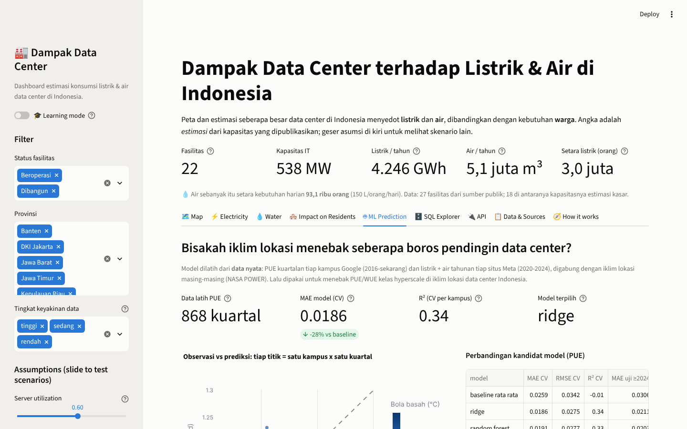
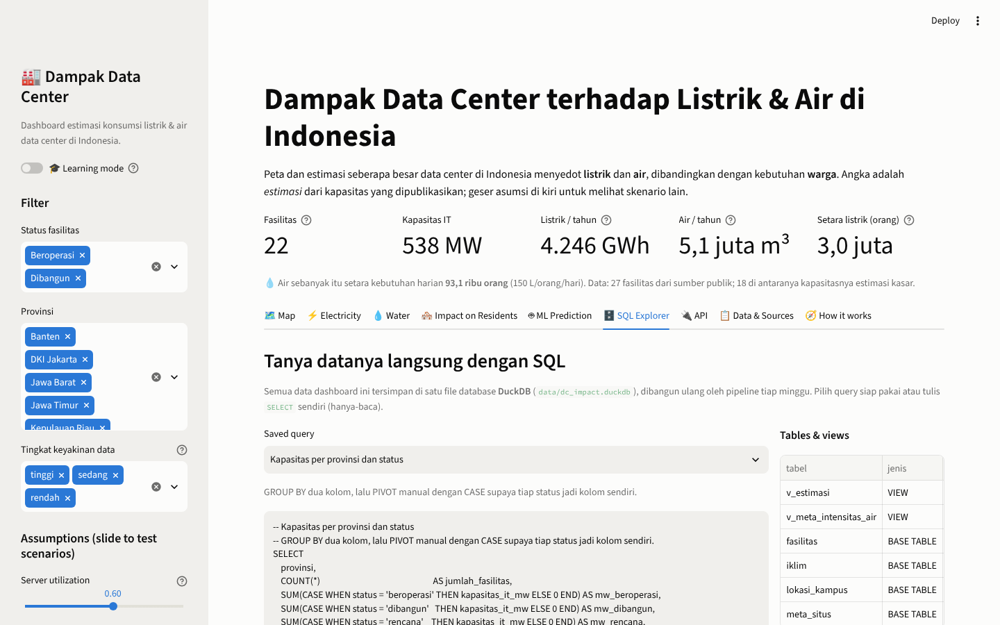
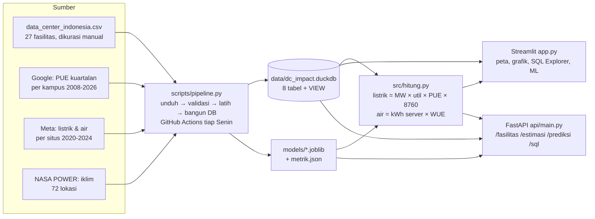

# 🏭 Dashboard Dampak Data Center Indonesia

[](https://github.com/Avalon2222/dc-impact-dashboard/actions/workflows/tests.yml) [](https://www.python.org/) [](LICENSE) [](https://dc-impact-dashboard.streamlit.app)

> Peta interaktif dan estimasi konsumsi **listrik** dan **air** data center di Indonesia,
> dibandingkan dengan kebutuhan **warga**. Di belakangnya: database DuckDB, pipeline data mingguan,
> model prediksi PUE dari iklim (dilatih dari data Google & Meta), dan API FastAPI.

## 🇬🇧 In English

**How thirsty is the cloud?** An interactive dashboard that maps 27 data centers in Indonesia and estimates how much electricity and cooling water each one uses, then translates those numbers into something people can feel: how many residents, households, or water trucks that equals.

- **Map** every facility by IT capacity (MW) and status: operating, under construction, or planned.
- **Estimate** power and water from PUE, WUE and utilization, with three cooling-technology scenarios.
- **Compare** a single facility against the needs of a neighborhood, village, or district.
- **Query** everything with SQL: the data lives in a DuckDB file with saved queries and a read-only SQL explorer.
- **Predict** PUE from climate: a Ridge model trained on 868 campus-quarters of Google's published PUE,
  evaluated with leave-campus-out cross-validation (MAE 0.019 vs 0.026 baseline, R² 0.34),
  then applied to Indonesian sites. The water model honestly failed its quality gate, and the dashboard says so.
- **Serve** the same numbers over HTTP with a FastAPI service (Docker image included).

**Built with:** Python, pandas, DuckDB, scikit-learn, FastAPI, Plotly, Streamlit  
**Data:** Public company announcements and news for Indonesian facilities, Google's quarterly per-campus PUE, Meta's per-site electricity and water, and NASA POWER climate reanalysis (every row has a source and a confidence level)  
**Engineering:** Weekly data pipeline on GitHub Actions (download → validate → train → rebuild DB), 5 test modules, CI, Dockerfile, and a built-in learning mode that explains every formula and model

*The rest of this README is in Indonesian.*

**🚀 Coba langsung di browser:** [dc-impact-dashboard.streamlit.app](https://dc-impact-dashboard.streamlit.app)


## Kenapa project ini ada?

Indonesia sedang jadi tujuan investasi data center (koridor Bekasi-Cikarang-Karawang dan Batam).
Data center butuh listrik besar dan, tergantung teknologi pendinginnya, air dalam jumlah besar.
Dua kebutuhan itu bersaing dengan kebutuhan warga di daerah yang sama. Dashboard ini mencoba
menjawab pertanyaan sederhana secara visual:

1. **Di mana** data center Indonesia berada, dan seberapa besar?
2. **Berapa listrik dan air** yang kira-kira mereka pakai?
3. **Setara berapa orang / rumah tangga** kebutuhan itu?
4. Apa yang berubah kalau **asumsi** (PUE, WUE, utilisasi) diubah?
5. Bisakah **iklim** lokasi dipakai untuk menebak seberapa boros pendingin data center?

Project ini lahir dari rasa penasaran pribadi setelah membaca berita investasi data center di Bekasi dan Batam.
Versi pertamanya hanya peta + rumus. Versi sekarang menambahkan database, pipeline otomatis, model prediksi,
dan API, supaya angkanya bisa ditanya dengan SQL, diperbarui sendiri tiap minggu, dan dipakai program lain.

## Fitur

| Tab | Isi |
|---|---|
| 🗺️ Map | Scatter map: ukuran = kapasitas IT (MW), warna = status (beroperasi / dibangun / rencana) |
| ⚡ Electricity | 15 fasilitas terboros, total per kabupaten/kota, kapasitas beroperasi vs pipeline |
| 💧 Water | Estimasi air pendingin per fasilitas + 3 skenario teknologi pendingin (WUE 0,3 / 1,8 / 3,5) |
| 🏘️ Impact on Residents | Pilih satu fasilitas → setara berapa orang, rumah tangga, truk tangki; skala log vs RW/kelurahan/kecamatan |
| 🤖 ML Prediction | Model PUE dari iklim: observasi vs prediksi, perbandingan kandidat, pentingnya fitur, prediksi per lokasi Indonesia, dan hasil negatif model air |
| 🗄️ SQL Explorer | 8 query tersimpan (JOIN, window function, QUALIFY) + editor SELECT bebas di atas DuckDB, grafik cepat, download CSV |
| 🔌 API | Daftar endpoint FastAPI + "coba langsung" yang menjalankan API di dalam proses |
| 📋 Data & Sources | Tabel lengkap + link sumber + tingkat keyakinan + download CSV + daftar keterbatasan |
| 🧭 How it works | Diagram alur: sumber data → pipeline → DuckDB & model → dashboard & API |
| 🎓 Learning mode | Toggle di sidebar: tiap tab dapat expander berisi rumus, potongan kode, dan latihan |

Semua asumsi bisa digeser lewat slider di sidebar dan seluruh dashboard langsung menghitung ulang.
Toggle **PUE from climate model** mengganti PUE tunggal dengan PUE hasil model untuk tiap lokasi.





## Cara menjalankan

```bash
git clone <url-repo-ini>
cd dc-impact-dashboard
python -m venv .venv && source .venv/bin/activate   # Windows: .venv\Scripts\activate
pip install -r requirements.txt
streamlit run app.py
```

Buka `http://localhost:8501`. Jalankan tes dengan `python -m pytest tests/ -v`.

```bash
# API (dokumentasi interaktif di http://127.0.0.1:8000/docs)
uvicorn api.main:app --reload
# atau lewat Docker
docker build -t dc-impact-api . && docker run -p 8000:8000 dc-impact-api

# Pipeline data: unduh PUE Google + iklim NASA POWER, validasi, latih model, bangun DuckDB
python scripts/pipeline.py              # butuh internet, ~2 menit
python scripts/pipeline.py --tanpa-unduh
```

## Arsitektur



Satu logika (`src/`), tiga pintu: dashboard untuk manusia, API untuk program, SQL untuk pertanyaan baru.

### Rumus estimasi

Semua ada di `src/hitung.py` (dengan docstring dan contoh angka) dan ditulis ulang sebagai VIEW SQL `v_estimasi`
di DuckDB; tes memastikan keduanya memberi angka yang sama.

| Besaran | Rumus | Default |
|---|---|---|
| Listrik per tahun (GWh) | kapasitas IT (MW) × utilisasi × PUE × 8.760 jam ÷ 1.000 | utilisasi 0,6; PUE 1,5 |
| Air per tahun (m³) | kapasitas IT (MW) × utilisasi × 8.760 × 1.000 × WUE ÷ 1.000 | WUE 1,8 L/kWh |
| Setara orang (listrik) | GWh × 1.000.000 ÷ 1.411 kWh/orang/tahun | ESDM 2024 |
| Setara orang (air) | m³ × 1.000 ÷ (150 L/orang/hari × 365) | SNI kota besar |

### Database & SQL

`data/dc_impact.duckdb` dibangun oleh `scripts/bangun_db.py` dari semua CSV. Tabel: `fasilitas`, `parameter`,
`pue_google`, `meta_situs`, `lokasi_kampus`, `iklim`, `prediksi_lokasi`, `metrik_model`; VIEW: `v_estimasi`,
`v_meta_intensitas_air`. Folder `sql/` berisi 8 query siap pakai, misalnya:

```sql
-- PUE terbaru tiap kampus Google (sql/04_pue_google_terbaru.sql)
SELECT kampus, tahun, kuartal, pue_kuartalan
FROM pue_google
WHERE kampus <> 'Fleet'
QUALIFY ROW_NUMBER() OVER (PARTITION BY kampus ORDER BY tahun DESC, kuartal DESC) = 1
ORDER BY pue_kuartalan DESC;
```

`src/db.py` hanya mengizinkan `SELECT`/`WITH` (satu pernyataan, tanpa kata kunci pengubah data), dan membangun
database di memori dari CSV kalau filenya tidak ada.

### Pipeline otomatis

`scripts/pipeline.py` = `ambil_pue_google.py` (parser HTML halaman efisiensi Google) → `ambil_iklim.py`
(NASA POWER harian → ringkasan kuartalan & tahunan) → validasi skema dan rentang nilai → `latih_model.py` →
`bangun_db.py`. Workflow `perbarui-data.yml` menjalankannya tiap Senin 03:17 UTC dan membuat commit
"Perbarui data mingguan" hanya kalau ada CSV yang berubah.

### Model prediksi PUE & WUE dari iklim

Hipotesis: pendingin bekerja lebih berat di udara panas-lembap, jadi iklim lokasi seharusnya bisa menebak PUE
(dan mungkin WUE). Data latih nyata: PUE kuartalan per kampus Google (868 baris, 35 kampus) dan
intensitas air per situs Meta (71 baris, 16 situs), masing-masing di-JOIN dengan iklim NASA POWER
lokasinya. Empat kandidat (baseline rata-rata, Ridge, Random Forest, Gradient Boosting) diuji dengan
**GroupKFold per kampus** (kampus yang diuji tidak pernah dilihat saat latih) plus uji waktu (latih ≤ 2023, uji ≥ 2024).
Model hanya dipakai kalau lolos gerbang: MAE ≤ 85% baseline dan R² ≥ 0,2.

| Target | Terpilih | MAE CV | R² CV | MAE baseline | MAE uji ≥2024 | Lolos? |
|---|---|---|---|---|---|---|
| PUE kuartalan | ridge | 0.0186 | 0.34 | 0.0259 | 0.0211 | ya |
| WUE tahunan | baseline rata rata | 0.222 | -0.12 | 0.222 | – | tidak |

Prediksi PUE kelas hyperscale untuk lokasi Indonesia: 1.13–1.14 (Bekasi paling rendah, Batam paling tinggi),
konsisten dengan kampus Google Singapura (1,12–1,15). Fasilitas kolokasi biasa umumnya 1,4–1,7, jadi angka itu
batas bawah. Model WUE **gagal** di gerbang: situs Meta yang paling boros air (Clonee, Odense) justru di iklim
sejuk, jadi teknologi pendingin dan sumber air yang menentukan, bukan cuaca. Pipeline memilih baseline dan
dashboard menampilkannya apa adanya. Semua angka: `models/metrik.json`.

### API

| Metode | Endpoint | Fungsi |
|---|---|---|
| GET | `/fasilitas`, `/fasilitas/{id}` | Data fasilitas, filter status/provinsi/keyakinan/min_mw |
| GET | `/ringkasan`, `/estimasi` | Total per provinsi dan estimasi satu fasilitas dengan asumsi dari query string |
| GET | `/prediksi/lokasi` | Prediksi PUE/WUE per lokasi Indonesia |
| POST | `/prediksi/pue`, `/prediksi/wue` | Prediksi dari ringkasan iklim yang dikirim |
| GET | `/model/metrik` | Metrik evaluasi model |
| GET/POST | `/sql/tersimpan`, `/sql` | Query tersimpan dan SELECT bebas (hanya-baca) |

Input divalidasi Pydantic (`kapasitas_it_mw=-1` → 422), dokumentasi otomatis di `/docs`.

## Data dan kejujuran soal estimasi

Dataset (`data/data_center_indonesia.csv`) berisi **27 fasilitas** yang dikumpulkan dari sumber publik
(siaran pers operator, liputan media, direktori industri) per Oktober 2026. Setiap baris punya
kolom `keyakinan`:

- **tinggi** – angka dari operator / liputan langsung, URL tercantum.
- **sedang** – direktori industri atau sumber sekunder.
- **rendah** – kapasitas **tidak dipublikasikan** (misalnya AWS, Microsoft, Google); angka adalah
  estimasi kasar kami dan ditulis terang-terangan di kolom `catatan`.

Koordinat adalah perkiraan area, bukan alamat persis. Daftar sumber dan alasan tiap angka ada di
[`data/SUMBER_DATA.md`](data/SUMBER_DATA.md). Dataset ini bukan daftar lengkap; mohon buka *issue*
atau *pull request* kalau punya angka yang lebih baik.

Keterbatasan penting: PUE dan WUE per fasilitas di Indonesia hampir tidak pernah dipublikasikan,
jadi semua angka air adalah **skenario**, bukan pengukuran. Itu justru pertanyaan lanjutan yang menarik.

## Struktur repo

```
dc-impact-dashboard/
├── app.py                      # tampilan Streamlit (baca dari atas ke bawah)
├── api/main.py                 # FastAPI di atas src/, DuckDB, dan model
├── src/
│   ├── muat_data.py            # baca & rapikan CSV
│   ├── hitung.py               # rumus estimasi (murni Python, mudah dites)
│   ├── db.py                   # koneksi DuckDB hanya-baca, penjaga SQL, query tersimpan
│   └── model.py                # fitur + muat model + prediksi (dipakai app, API, skrip)
├── scripts/
│   ├── pipeline.py             # orkestrasi: unduh → validasi → latih → bangun DB
│   ├── ambil_pue_google.py     # parser halaman efisiensi Google
│   ├── ambil_iklim.py          # NASA POWER harian → ringkasan kuartalan/tahunan
│   ├── latih_model.py          # kandidat model, GroupKFold, gerbang kelayakan
│   └── bangun_db.py            # CSV → DuckDB + VIEW
├── sql/                        # 8 query siap pakai (judul = komentar baris pertama)
├── data/
│   ├── data_center_indonesia.csv, parameter_asumsi.csv
│   ├── pue_google_kuartalan.csv, meta_listrik_air_tahunan.csv, lokasi_kampus.csv, iklim_kuartalan.csv
│   ├── prediksi_lokasi.csv, evaluasi_pue_oof.csv, evaluasi_wue_oof.csv
│   ├── dc_impact.duckdb        # database (dibangun ulang pipeline)
│   └── SUMBER_DATA.md
├── models/                     # model_pue.joblib, model_wue.joblib, metrik.json
├── tests/                      # test_hitung, test_db, test_model, test_api, test_pipeline
├── docs/                       # BELAJAR.md, LATIHAN.md, screenshots/
├── .github/workflows/          # tests.yml (CI), perbarui-data.yml (pipeline mingguan)
├── Dockerfile                  # image API
└── requirements.txt
```

## Belajar dari project ini

Jika kamu baru mulai Python/data, baca [`docs/BELAJAR.md`](docs/BELAJAR.md) dulu (alur, konsep
pandas & Streamlit, kenapa kodenya dipisah begini), lalu kerjakan [`docs/LATIHAN.md`](docs/LATIHAN.md).
Nyalakan **Mode belajar** di sidebar supaya tiap grafik menunjukkan kode di baliknya.

## Rencana berikutnya

- [x] Deploy ke Streamlit Community Cloud.
- [x] Database SQL, pipeline otomatis, model prediksi, API.
- [ ] Verifikasi ulang fasilitas berkeyakinan rendah; tambah fasilitas kecil (enterprise/edge).
- [ ] Tambah sumber listrik per wilayah (bauran PLTU vs terbarukan) → estimasi emisi CO₂.
- [ ] Tambah lapisan ketersediaan air (cekungan air tanah kritis, wilayah PDAM) untuk konteks dampak.
- [ ] Cari data WUE per situs dari operator lain (Microsoft, Equinix) supaya model air punya cukup data.
- [ ] Deploy API ke layanan gratis (Render/Fly) dan hubungkan ke chatbot talk-to-the-data.

## Lisensi

Kode: MIT. Data: kompilasi dari sumber publik yang disebutkan; gunakan dengan menyebut sumber aslinya.
