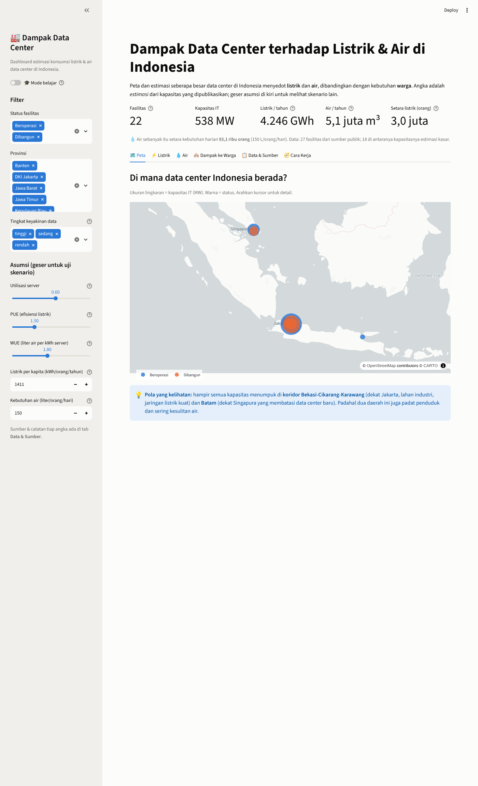
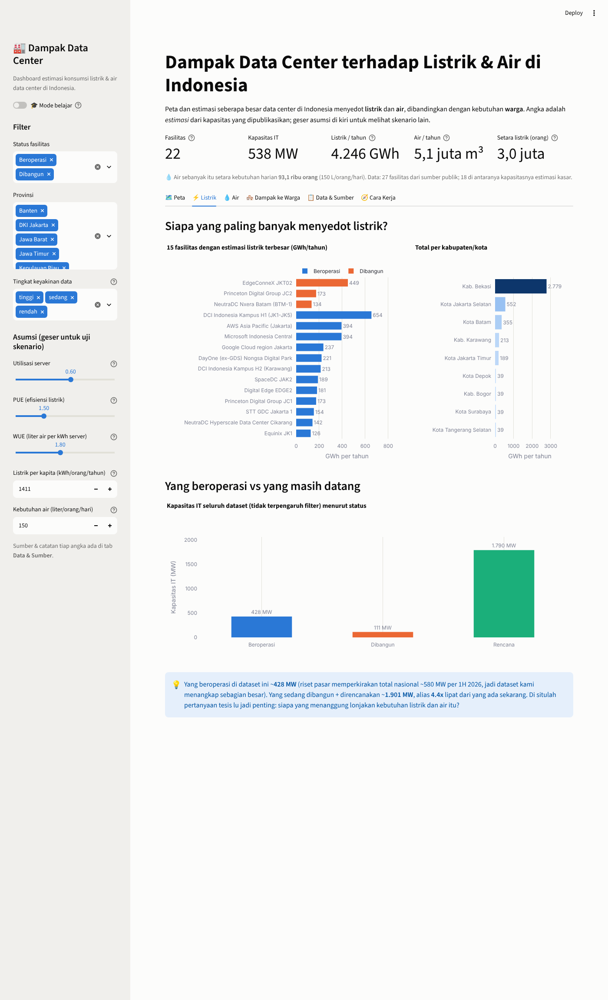
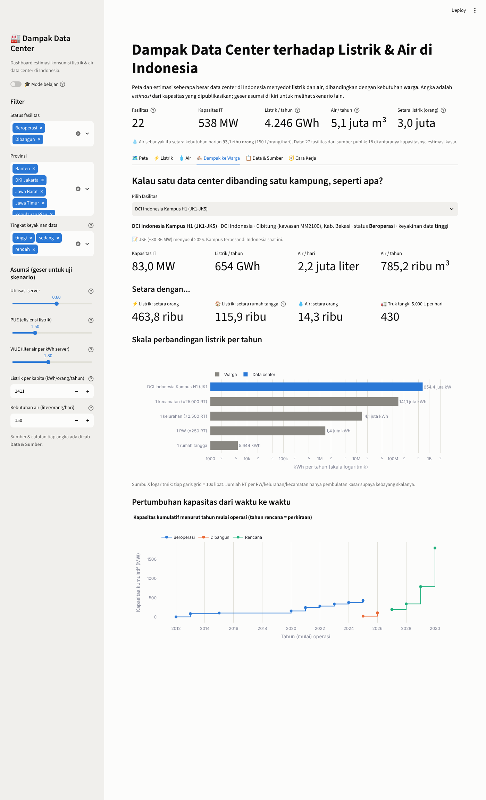
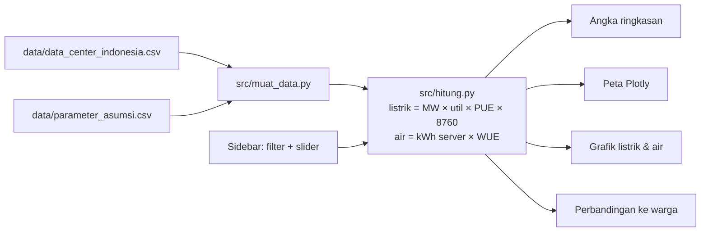

# 🏭 Dashboard Dampak Data Center Indonesia

[](https://github.com/Avalon2222/dc-impact-dashboard/actions/workflows/tests.yml) [](https://www.python.org/) [](LICENSE) [](https://dc-impact-dashboard.streamlit.app)

> Peta interaktif dan estimasi konsumsi **listrik** dan **air** data center di Indonesia,
> dibandingkan dengan kebutuhan **warga**. Dibangun dengan Python, pandas, Plotly, dan Streamlit.

## 🇬🇧 In English

**How thirsty is the cloud?** An interactive dashboard that maps 27 data centers in Indonesia and estimates how much electricity and cooling water each one uses, then translates those numbers into something people can feel: how many residents, households, or water trucks that equals.

- **Map** every facility by IT capacity (MW) and status: operating, under construction, or planned.
- **Estimate** power and water from PUE, WUE and utilization, with three cooling-technology scenarios.
- **Compare** a single facility against the needs of a neighborhood, village, or district.
- **Tweak** every assumption with sidebar sliders and watch the whole dashboard recompute.

**Built with:** Python, pandas, Plotly, Streamlit  
**Data:** Public company announcements and news, plus published PUE/WUE benchmarks (every row has a source and a confidence level)  
**Engineering:** Unit-tested calculation module, CI on GitHub Actions, and a built-in learning mode that explains every formula

*The rest of this README is in Indonesian.*

**🚀 Coba langsung di browser:** [dc-impact-dashboard.streamlit.app](https://dc-impact-dashboard.streamlit.app)



## Kenapa project ini ada?

Indonesia sedang jadi tujuan investasi data center (koridor Bekasi-Cikarang-Karawang dan Batam).
Data center butuh listrik besar dan, tergantung teknologi pendinginnya, air dalam jumlah besar.
Dua kebutuhan itu bersaing dengan kebutuhan warga di daerah yang sama. Dashboard ini mencoba
menjawab pertanyaan sederhana secara visual:

1. **Di mana** data center Indonesia berada, dan seberapa besar?
2. **Berapa listrik dan air** yang kira-kira mereka pakai?
3. **Setara berapa orang / rumah tangga** kebutuhan itu?
4. Apa yang berubah kalau **asumsi** (PUE, WUE, utilisasi) diubah?

Project ini lahir dari rasa penasaran pribadi setelah membaca berita investasi data center di Bekasi dan Batam.

## Fitur

| Tab | Isi |
|---|---|
| 🗺️ Map | Scatter map: ukuran = kapasitas IT (MW), warna = status (beroperasi / dibangun / rencana) |
| ⚡ Electricity | 15 fasilitas terboros, total per kabupaten/kota, kapasitas beroperasi vs pipeline |
| 💧 Water | Estimasi air pendingin per fasilitas + 3 skenario teknologi pendingin (WUE 0,3 / 1,8 / 3,5) |
| 🏘️ Impact on Residents | Pilih satu fasilitas → setara berapa orang, rumah tangga, truk tangki; skala log vs RW/kelurahan/kecamatan |
| 📋 Data & Sources | Tabel lengkap + link sumber + tingkat keyakinan + download CSV + daftar keterbatasan |
| 🧭 How it works | Diagram alur data → rumus → grafik |
| 🎓 Learning mode | Toggle di sidebar: tiap grafik dapat expander berisi rumus, potongan kode, dan latihan |

Semua asumsi bisa digeser lewat slider di sidebar dan seluruh dashboard langsung menghitung ulang.




## Cara menjalankan

```bash
git clone <url-repo-ini>
cd dc-impact-dashboard
python -m venv .venv && source .venv/bin/activate   # Windows: .venv\Scripts\activate
pip install -r requirements.txt
streamlit run app.py
```

Buka `http://localhost:8501`. Jalankan tes dengan `python -m pytest tests/ -v`.

## Cara kerja (ringkas)



Rumus utama (semua ada di `src/hitung.py`, lengkap dengan docstring dan contoh angka):

| Besaran | Rumus | Default |
|---|---|---|
| Listrik per tahun (GWh) | kapasitas IT (MW) × utilisasi × PUE × 8.760 jam ÷ 1.000 | utilisasi 0,6; PUE 1,5 |
| Air per tahun (m³) | kapasitas IT (MW) × utilisasi × 8.760 × 1.000 × WUE ÷ 1.000 | WUE 1,8 L/kWh |
| Setara orang (listrik) | GWh × 1.000.000 ÷ 1.411 kWh/orang/tahun | ESDM 2024 |
| Setara orang (air) | m³ × 1.000 ÷ (150 L/orang/hari × 365) | SNI kota besar |

## Data dan kejujuran soal estimasi

Dataset (`data/data_center_indonesia.csv`) berisi **27 fasilitas** yang dikumpulkan dari sumber publik
(siaran pers operator, liputan media, direktori industri) per Oktober 2026. Setiap baris punya
kolom `keyakinan`:

- **tinggi** – angka dari operator / liputan langsung, URL tercantum.
- **sedang** – direktori industri atau sumber sekunder.
- **rendah** – kapasitas **tidak dipublikasikan** (misalnya AWS, Microsoft, Google); angka adalah
  estimasi kasar kami dan ditulis terang-terangan di kolom `catatan`.

Koordinat adalah perkiraan area, bukan alamat persis. Daftar sumber dan alasan tiap angka ada di
[`data/SUMBER_DATA.md`](data/SUMBER_DATA.md). Dataset ini bukan daftar lengkap; mohon buka *issue*
atau *pull request* kalau punya angka yang lebih baik.

Keterbatasan penting: PUE dan WUE per fasilitas di Indonesia hampir tidak pernah dipublikasikan,
jadi semua angka air adalah **skenario**, bukan pengukuran. Itu justru pertanyaan lanjutan yang menarik.

## Struktur repo

```
dc-impact-dashboard/
├── app.py                  # tampilan Streamlit (baca dari atas ke bawah)
├── src/
│   ├── muat_data.py        # baca & rapikan CSV
│   └── hitung.py           # rumus estimasi (murni Python, mudah dites)
├── data/
│   ├── data_center_indonesia.csv
│   ├── parameter_asumsi.csv
│   └── SUMBER_DATA.md
├── tests/test_hitung.py    # 9 tes pytest
├── docs/
│   ├── BELAJAR.md          # panduan belajar step by step
│   ├── LATIHAN.md          # latihan kecil + kunci jawaban
│   └── screenshots/
└── requirements.txt
```

## Belajar dari project ini

Jika kamu baru mulai Python/data, baca [`docs/BELAJAR.md`](docs/BELAJAR.md) dulu (alur, konsep
pandas & Streamlit, kenapa kodenya dipisah begini), lalu kerjakan [`docs/LATIHAN.md`](docs/LATIHAN.md).
Nyalakan **Mode belajar** di sidebar supaya tiap grafik menunjukkan kode di baliknya.

## Rencana berikutnya

- [ ] Verifikasi ulang fasilitas berkeyakinan rendah; tambah fasilitas kecil (enterprise/edge).
- [ ] Tambah sumber listrik per wilayah (bauran PLTU vs terbarukan) → estimasi emisi CO₂.
- [ ] Tambah lapisan ketersediaan air (cekungan air tanah kritis, wilayah PDAM) untuk konteks dampak.
- [ ] Deploy ke Streamlit Community Cloud.

## Lisensi

Kode: MIT. Data: kompilasi dari sumber publik yang disebutkan; gunakan dengan menyebut sumber aslinya.
