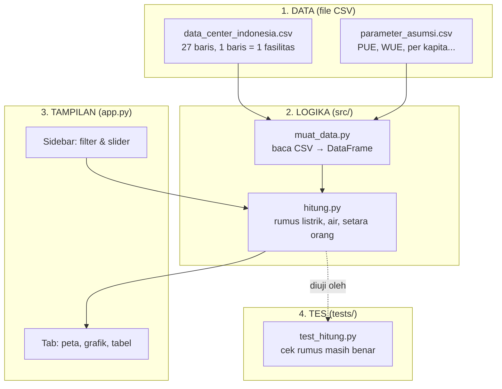
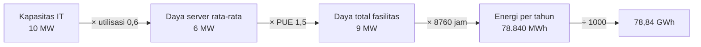

# 🎓 Panduan Belajar: Bedah Dashboard dari Nol

Panduan ini buat kamu yang baru tahu Python "sedikit-sedikit". Tujuannya bukan ngafalin kode,
tapi **paham kenapa kodenya begitu**. Baca pelan-pelan, buka file yang disebut, dan coba ubah
sesuatu di tiap bagian. Kalau rusak, `git checkout app.py` balikin lagi. Rusak itu bagian dari belajar.

Estimasi waktu: 2–3 jam santai, dibagi beberapa sesi.

---

## Peta besar: 4 lapisan



**Kenapa dipisah 4 lapisan?** Supaya tiap bagian bisa diubah tanpa merusak yang lain:

- Mau nambah data center? Cukup edit **CSV**. Nggak perlu sentuh kode.
- Mau ganti rumus? Edit **hitung.py**, jalankan tes, selesai. Tampilan nggak berubah.
- Mau ganti warna grafik? Edit **app.py** aja.

Ini prinsip yang dipakai di hampir semua software: *separation of concerns*.

---

## Langkah 1 — Kenalan sama data (pandas)

Buka terminal di folder project, jalankan `python`, lalu ketik:

```python
import pandas as pd
df = pd.read_csv("data/data_center_indonesia.csv")

df.shape            # (27, 16) -> 27 baris, 16 kolom
df.head(3)          # 3 baris pertama
df.columns          # nama-nama kolom
df["kapasitas_it_mw"].sum()         # total MW
df["status"].value_counts()         # berapa yang beroperasi/dibangun/rencana
df[df["provinsi"] == "Kepulauan Riau"]   # filter: hanya Batam & Bintan
```

**Konsep kunci — DataFrame** = tabel Excel versi Python. Baris = fasilitas, kolom = atribut.
Tiga operasi yang dipakai di seluruh dashboard cuma ini:

| Operasi | Kode | Analogi Excel |
|---|---|---|
| Filter baris | `df[df["status"] == "beroperasi"]` | Filter dropdown |
| Kolom baru dari rumus | `df["x"] = df["a"] * 2` | Rumus yang ditarik ke bawah |
| Kelompokkan & jumlahkan | `df.groupby("provinsi")["kapasitas_it_mw"].sum()` | Pivot table |

Coba: hitung total MW per provinsi dengan `groupby`. Bandingkan hasilnya dengan grafik di tab Listrik.

---

## Langkah 2 — Rumus (src/hitung.py)

Buka `src/hitung.py`. Perhatikan: **tidak ada Streamlit, tidak ada grafik**. Cuma fungsi Python murni
yang menerima angka dan mengembalikan angka. Ini sengaja: fungsi murni gampang dites dan dipakai ulang.

### Rumus listrik

```
Listrik per tahun (GWh) = MW × utilisasi × PUE × 8760 ÷ 1000
```

Bacanya begini, satu langkah satu satuan:



- **Utilisasi**: server jarang jalan 100%. 0,6 artinya rata-rata 60% kapasitas terpakai.
- **PUE** (*Power Usage Effectiveness*): listrik total ÷ listrik server. Sisanya buat pendingin, lampu, UPS.
  PUE 1,5 = tiap 1 kWh ke server, fasilitas butuh 1,5 kWh. Data center super efisien ~1,1; yang tua bisa 2,0.
- **8760** = 365 hari × 24 jam. MW × jam = MWh (energi).

### Rumus air

```
Air per tahun (m³) = MW × utilisasi × 8760 × 1000 × WUE ÷ 1000
```

- **WUE** (*Water Usage Effectiveness*): liter air per kWh **listrik server**. Karena definisinya per kWh server,
  PUE **tidak** ikut dikali. Ini jebakan umum; kalau kamu kalikan PUE, angkamu kegedean 50%.
- `× 1000` pertama: MWh → kWh. `÷ 1000` terakhir: liter → m³.
- WUE 0 = pendingin tanpa air (udara / closed-loop). 1,8 = rata-rata industri. 3–4 = evaporatif di iklim panas.

### Rumus "setara orang"

```
Setara orang (listrik) = GWh × 1.000.000 ÷ kWh per orang per tahun
Setara orang (air)     = m³ × 1000 ÷ (liter per orang per hari × 365)
```

Ini cara mengubah angka abstrak (GWh) jadi sesuatu yang kebayang ("setara 400 ribu orang").
Catatan jujur: angka per kapita ESDM sudah termasuk industri, jadi ini ilustrasi, bukan klaim presisi.

**Coba sendiri** di `python`:

```python
from src import hitung
hitung.listrik_tahunan_gwh(10, 0.6, 1.5)    # 78.84
hitung.air_tahunan_m3(10, 0.6, 1.8)         # 94608.0
hitung.setara_penduduk_listrik(78.84, 1411) # ~55.875 orang
```

---

## Langkah 3 — Tes (tests/test_hitung.py)

Jalankan `python -m pytest tests/ -v`. Kamu akan lihat 9 baris `PASSED`.

Tes itu cuma fungsi yang namanya diawali `test_` dan berisi `assert` (pernyataan "ini harus benar"):

```python
def test_listrik_contoh_di_docstring():
    assert hitung.listrik_tahunan_gwh(10, 0.6, 1.5) == pytest.approx(78.84)
```

`pytest.approx` dipakai karena angka desimal di komputer kadang 78.8400000001. Tes paling berguna
di sini adalah `test_dataset_bisa_dimuat_dan_valid`: dia menolak koordinat di luar Indonesia.
Kalau kamu salah ketik `lat` jadi `60.28` (bukan `-6.28`), tes langsung merah sebelum petanya aneh.

**Kebiasaan bagus:** setiap kali ubah rumus atau data → jalankan tes.

---

## Langkah 4 — Streamlit: cara berpikir "rerun dari atas"

Buka `app.py`. Hal paling penting tentang Streamlit:

> **Setiap kali kamu geser slider atau klik apa pun, Streamlit menjalankan ulang SELURUH `app.py` dari baris pertama.**


Konsekuensinya:

1. Nggak perlu kode "kalau slider berubah, update grafik". Cukup tulis alurnya sekali, urut dari atas.
2. Baca CSV tiap rerun itu boros → dibungkus `@st.cache_data` supaya cuma dibaca sekali.
3. Variabel yang kamu ambil dari widget (`pue = st.slider(...)`) langsung berisi nilai terbaru.

### Anatomi app.py

| Bagian | Baris kira-kira | Apa yang terjadi |
|---|---|---|
| 0. Konfigurasi | atas | `st.set_page_config`, kamus warna, fungsi `rapikan()` untuk gaya grafik seragam |
| 1. Muat data | `ambil_data()` | baca 2 CSV, di-cache |
| 2. Sidebar | `with st.sidebar:` | multiselect filter, slider asumsi. Nilainya masuk ke variabel biasa |
| 3. Filter + hitung | `df = df_mentah[...]` lalu `tambah_kolom_estimasi` | DataFrame baru dengan kolom estimasi |
| 4. Header + KPI | `st.metric` × 5 | angka ringkasan |
| 5. Tab | `st.tabs([...])` lalu `with tab_x:` | tiap tab berisi grafik Plotly + `st.info` insight |

Perhatikan pola yang berulang di setiap grafik:

```python
fig = px.bar(df_kecil, x=..., y=..., color=...)   # 1. bikin figur dari DataFrame
fig.update_traces(...)                            # 2. rapikan detail batang/teks
rapikan(fig, 520)                                 # 3. gaya seragam (fungsi kita sendiri)
st.plotly_chart(fig, use_container_width=True)    # 4. tempel ke halaman
```

Kalau sudah paham pola ini, kamu bisa bikin grafik apa pun.

---

## Langkah 5 — Plotly Express: grafik dalam satu baris

`px` (Plotly Express) menerima DataFrame dan nama kolom. Dia yang urus sumbu, legenda, tooltip.

```python
px.bar(df, x="listrik_gwh_tahun", y="nama", orientation="h", color="status_label")
px.scatter_map(df, lat="lat", lon="lon", size="kapasitas_it_mw", color="status_label")
px.line(garis, x="tahun", y="kumulatif_mw", color="status_label", line_shape="hv")
```

Tiga keputusan desain yang sengaja diambil (dan layak kamu tiru):

1. **Satu status = satu warna, tetap.** `WARNA_STATUS` adalah kamus; warna nggak berubah walau filter berubah.
2. **Sumbu log** di perbandingan warga, karena 5.644 kWh (1 rumah) vs 654 juta kWh (1 DC) bedanya 100.000×.
3. **Angka ditulis di ujung batang** (`text=`), bukan dibaca dari sumbu. Lebih cepat dibaca orang.

---

## Langkah 6 — Kejujuran data (bagian paling penting)

Kolom `keyakinan` (tinggi/sedang/rendah) dan `catatan` ada supaya pembaca tahu mana angka resmi dan
mana estimasi. Di riset, ini namanya **transparansi metodologi**. Dashboard yang jujur soal
ketidakpastian lebih dipercaya daripada yang pura-pura presisi.

Coba filter "Tingkat keyakinan data" → hanya `tinggi`. Lihat angka totalnya turun drastis. Itu
pesan penting: sebagian besar kapasitas hyperscaler **tidak dipublikasikan**. Itu temuan penting tersendiri.

---

## Glosarium cepat

| Istilah | Arti singkat |
|---|---|
| Kapasitas IT (MW) | Daya maksimum yang disediakan untuk server |
| PUE | Listrik total ÷ listrik server (≥ 1; makin kecil makin efisien) |
| WUE | Liter air per kWh listrik server |
| Utilisasi | Persen kapasitas yang benar-benar terpakai |
| GWh | Gigawatt-jam = 1 juta kWh. Tagihan rumahmu dalam kWh |
| Kolokasi | Data center yang menyewakan rak ke banyak perusahaan |
| Hyperscale | Data center raksasa milik/untuk AWS, Google, Microsoft, dll |
| DataFrame | Tabel di pandas |
| Rerun | Streamlit menjalankan ulang seluruh skrip setiap interaksi |
| Cache | Menyimpan hasil supaya nggak dihitung ulang |

---

## Setelah ini

1. Kerjakan `docs/LATIHAN.md` (8 latihan, dari gampang sampai lumayan).
2. Push ke GitHub, pasang screenshot di README. Itu sudah portofolio.
3. Project berikutnya bisa memakai `hitung.py` yang sama sebagai *backend API*.
   Jadi apa yang kamu pelajari di sini langsung kepakai lagi.
