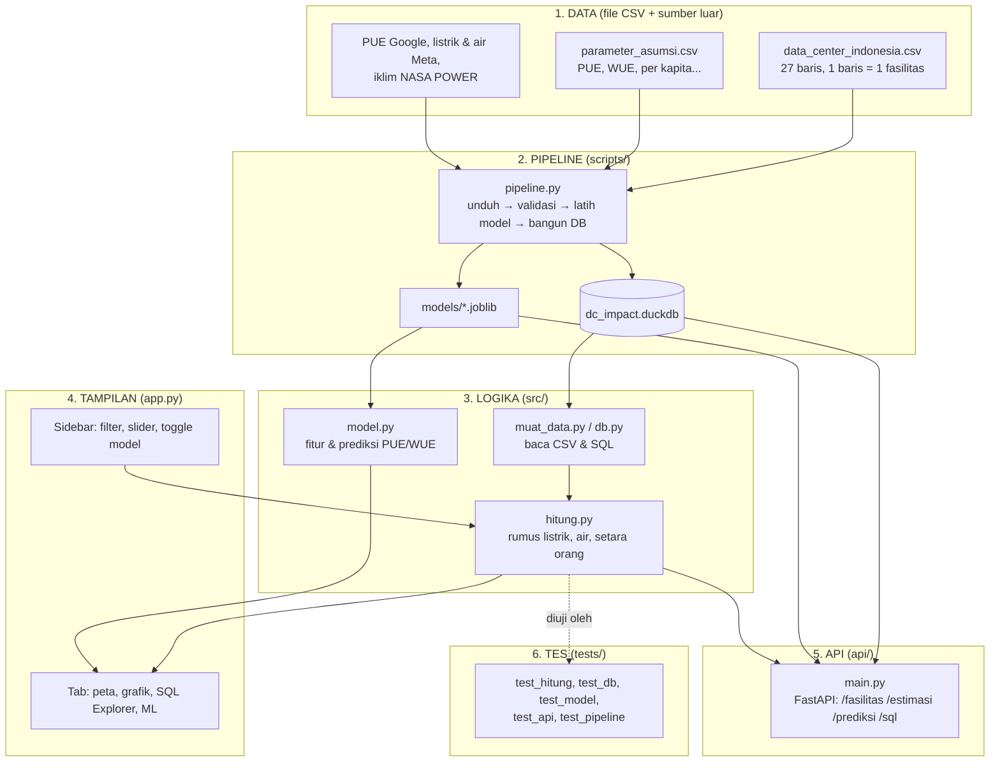
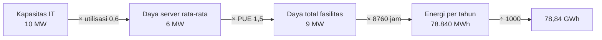
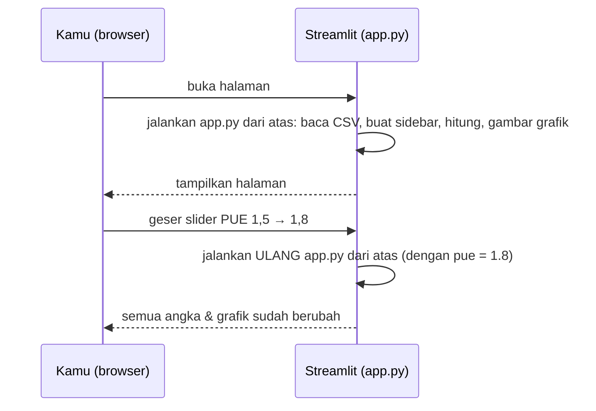

# 🎓 Panduan Belajar: Bedah Dashboard dari Nol

Panduan ini ditujukan untuk pembaca yang baru mengenal Python. Tujuannya bukan menghafal kode,
tapi **paham kenapa kodenya begitu**. Baca pelan-pelan, buka file yang disebut, dan coba ubah
sesuatu di tiap bagian. Jika ada yang rusak, `git checkout app.py` mengembalikannya. Rusak adalah bagian dari belajar.

Estimasi waktu: Langkah 1–6 sekitar 2–3 jam (dasar), Langkah 7–10 sekitar 3–4 jam (database, pipeline, model, API). Dapat dibagi menjadi beberapa sesi.

---

## Peta besar: 6 lapisan



**Kenapa dipisah banyak lapisan?** Supaya tiap bagian bisa diubah tanpa merusak yang lain:

- Ingin menambah data center? Cukup edit **CSV**, jalankan pipeline, tanpa menyentuh kode tampilan.
- Ingin mengganti rumus? Edit **hitung.py**, jalankan tes, selesai. Dashboard *dan* API ikut berubah.
- Ingin mengganti warna grafik? Cukup edit **app.py**.
- Ingin bertanya hal baru ke data? Tulis **SQL** di tab SQL Explorer, tanpa mengubah kode apa pun.

Langkah 1–6 membahas lapisan dasar (data, rumus, tes, Streamlit). Langkah 7–10 membahas lapisan
yang ditambahkan belakangan: database, pipeline, model prediksi, dan API.

Ini prinsip yang dipakai di hampir semua software: *separation of concerns*.

---

## Langkah 1 — Kenalan sama data (pandas)

Buka terminal di folder project, jalankan `python`, lalu ketik:

```python
import pandas as pd
df = pd.read_csv("data/data_center_indonesia.csv")

df.shape            # (27, 16) -> 27 baris, 16 kolom
df.head(3)          # 3 baris pertama
df.columns          # nama-nama kolom
df["kapasitas_it_mw"].sum()         # total MW
df["status"].value_counts()         # berapa yang beroperasi/dibangun/rencana
df[df["provinsi"] == "Kepulauan Riau"]   # filter: hanya Batam & Bintan
```

**Konsep kunci — DataFrame** = tabel Excel versi Python. Baris = fasilitas, kolom = atribut.
Tiga operasi yang dipakai di seluruh dashboard hanya ini:

| Operasi | Kode | Analogi Excel |
|---|---|---|
| Filter baris | `df[df["status"] == "beroperasi"]` | Filter dropdown |
| Kolom baru dari rumus | `df["x"] = df["a"] * 2` | Rumus yang ditarik ke bawah |
| Kelompokkan & jumlahkan | `df.groupby("provinsi")["kapasitas_it_mw"].sum()` | Pivot table |

Coba: hitung total MW per provinsi dengan `groupby`. Bandingkan hasilnya dengan grafik di tab Listrik.

---

## Langkah 2 — Rumus (src/hitung.py)

Buka `src/hitung.py`. Perhatikan: **tidak ada Streamlit, tidak ada grafik**. Cuma fungsi Python murni
yang menerima angka dan mengembalikan angka. Ini disengaja: fungsi murni mudah diuji dan dipakai ulang.

### Rumus listrik

```
Listrik per tahun (GWh) = MW × utilisasi × PUE × 8760 ÷ 1000
```

Bacanya begini, satu langkah satu satuan:



- **Utilisasi**: server jarang jalan 100%. 0,6 artinya rata-rata 60% kapasitas terpakai.
- **PUE** (*Power Usage Effectiveness*): listrik total ÷ listrik server. Sisanya buat pendingin, lampu, UPS.
  PUE 1,5 = tiap 1 kWh ke server, fasilitas butuh 1,5 kWh. Data center super efisien ~1,1; yang tua bisa 2,0.
- **8760** = 365 hari × 24 jam. MW × jam = MWh (energi).

### Rumus air

```
Air per tahun (m³) = MW × utilisasi × 8760 × 1000 × WUE ÷ 1000
```

- **WUE** (*Water Usage Effectiveness*): liter air per kWh **listrik server**. Karena definisinya per kWh server,
  PUE **tidak** ikut dikali. Ini jebakan umum; kalau kamu kalikan PUE, angkamu kegedean 50%.
- `× 1000` pertama: MWh → kWh. `÷ 1000` terakhir: liter → m³.
- WUE 0 = pendingin tanpa air (udara / closed-loop). 1,8 = rata-rata industri. 3–4 = evaporatif di iklim panas.

### Rumus "setara orang"

```
Setara orang (listrik) = GWh × 1.000.000 ÷ kWh per orang per tahun
Setara orang (air)     = m³ × 1000 ÷ (liter per orang per hari × 365)
```

Ini cara mengubah angka abstrak (GWh) menjadi sesuatu yang mudah dibayangkan ("setara 400 ribu orang").
Catatan jujur: angka per kapita ESDM sudah termasuk industri, jadi ini ilustrasi, bukan klaim presisi.

**Coba sendiri** di `python`:

```python
from src import hitung
hitung.listrik_tahunan_gwh(10, 0.6, 1.5)    # 78.84
hitung.air_tahunan_m3(10, 0.6, 1.8)         # 94608.0
hitung.setara_penduduk_listrik(78.84, 1411) # ~55.875 orang
```

---

## Langkah 3 — Tes (tests/test_hitung.py)

Jalankan `python -m pytest tests/ -v`. Kamu akan lihat 9 baris `PASSED`.

Tes itu hanya fungsi yang namanya diawali `test_` dan berisi `assert` (pernyataan "ini harus benar"):

```python
def test_listrik_contoh_di_docstring():
    assert hitung.listrik_tahunan_gwh(10, 0.6, 1.5) == pytest.approx(78.84)
```

`pytest.approx` dipakai karena angka desimal di komputer kadang 78.8400000001. Tes paling berguna
di sini adalah `test_dataset_bisa_dimuat_dan_valid`: dia menolak koordinat di luar Indonesia.
Kalau kamu salah ketik `lat` jadi `60.28` (bukan `-6.28`), tes langsung merah sebelum petanya aneh.

**Kebiasaan bagus:** setiap kali ubah rumus atau data → jalankan tes.

---

## Langkah 4 — Streamlit: cara berpikir "rerun dari atas"

Buka `app.py`. Hal paling penting tentang Streamlit:

> **Setiap kali kamu geser slider atau klik apa pun, Streamlit menjalankan ulang SELURUH `app.py` dari baris pertama.**



Konsekuensinya:

1. Tidak perlu kode "jika slider berubah, perbarui grafik". Cukup tulis alurnya sekali, urut dari atas.
2. Baca CSV tiap rerun itu boros → dibungkus `@st.cache_data` supaya hanya dibaca sekali.
3. Variabel yang kamu ambil dari widget (`pue = st.slider(...)`) langsung berisi nilai terbaru.

### Anatomi app.py

| Bagian | Baris kira-kira | Apa yang terjadi |
|---|---|---|
| 0. Konfigurasi | atas | `st.set_page_config`, kamus warna, fungsi `rapikan()` untuk gaya grafik seragam |
| 1. Muat data | `ambil_data()` | baca 2 CSV, di-cache |
| 2. Sidebar | `with st.sidebar:` | multiselect filter, slider asumsi. Nilainya masuk ke variabel biasa |
| 3. Filter + hitung | `df = df_mentah[...]` lalu `tambah_kolom_estimasi` | DataFrame baru dengan kolom estimasi |
| 4. Header + KPI | `st.metric` × 5 | angka ringkasan |
| 5. Tab | `st.tabs([...])` lalu `with tab_x:` | tiap tab berisi grafik Plotly + `st.info` insight |

Perhatikan pola yang berulang di setiap grafik:

```python
fig = px.bar(df_kecil, x=..., y=..., color=...)   # 1. buat figur dari DataFrame
fig.update_traces(...)                            # 2. rapikan detail batang/teks
rapikan(fig, 520)                                 # 3. gaya seragam (fungsi kita sendiri)
st.plotly_chart(fig, use_container_width=True)    # 4. tempel ke halaman
```

Jika sudah memahami pola ini, kamu bisa membuat grafik apa pun.

---

## Langkah 5 — Plotly Express: grafik dalam satu baris

`px` (Plotly Express) menerima DataFrame dan nama kolom. Dia yang urus sumbu, legenda, tooltip.

```python
px.bar(df, x="listrik_gwh_tahun", y="nama", orientation="h", color="status_label")
px.scatter_map(df, lat="lat", lon="lon", size="kapasitas_it_mw", color="status_label")
px.line(garis, x="tahun", y="kumulatif_mw", color="status_label", line_shape="hv")
```

Tiga keputusan desain yang sengaja diambil (dan layak kamu tiru):

1. **Satu status = satu warna, tetap.** `WARNA_STATUS` adalah kamus; warna tidak berubah walau filter berubah.
2. **Sumbu log** di perbandingan warga, karena 5.644 kWh (1 rumah) vs 654 juta kWh (1 DC) bedanya 100.000×.
3. **Angka ditulis di ujung batang** (`text=`), bukan dibaca dari sumbu. Lebih cepat dibaca orang.

---

## Langkah 6 — Kejujuran data (bagian paling penting)

Kolom `keyakinan` (tinggi/sedang/rendah) dan `catatan` ada supaya pembaca tahu mana angka resmi dan
mana estimasi. Di riset, ini namanya **transparansi metodologi**. Dashboard yang jujur soal
ketidakpastian lebih dipercaya daripada yang pura-pura presisi.

Coba filter "Tingkat keyakinan data" → hanya `tinggi`. Lihat angka totalnya turun drastis. Itu
pesan penting: sebagian besar kapasitas hyperscaler **tidak dipublikasikan**. Itu temuan penting tersendiri.

---

## Langkah 7 — Database: bertanya dengan SQL (DuckDB)

Semua CSV dimasukkan ke satu file database `data/dc_impact.duckdb` oleh `scripts/bangun_db.py`.
DuckDB adalah database analitik yang hidup dalam satu file, tanpa server, dan langsung bisa dipanggil dari Python:

```python
import duckdb
kon = duckdb.connect("data/dc_impact.duckdb", read_only=True)
kon.execute("SELECT provinsi, SUM(kapasitas_it_mw) AS mw FROM fasilitas GROUP BY provinsi ORDER BY mw DESC").df()
```

Bandingkan dengan versi pandas: `df.groupby("provinsi")["kapasitas_it_mw"].sum().sort_values(ascending=False)`.
Keduanya benar. SQL unggul saat pertanyaan melibatkan **beberapa tabel** (`JOIN`) atau **perhitungan berjalan**
(window function). Lihat folder `sql/`:

| File | Konsep SQL yang dipakai |
|---|---|
| `01_kapasitas_per_provinsi.sql` | `GROUP BY`, `CASE WHEN` (pivot manual) |
| `02_operator_terbesar.sql` | membaca `VIEW` (`v_estimasi`), `LIMIT` |
| `03_pertumbuhan_kumulatif.sql` | CTE (`WITH`), window function `SUM() OVER (ORDER BY ...)` |
| `04_pue_google_terbaru.sql` | `QUALIFY ROW_NUMBER() OVER (PARTITION BY ...)` |
| `06_pue_vs_iklim.sql` | `JOIN` tiga tabel, persis data latih model |
| `08_iklim_indonesia_vs_dunia.sql` | `UNION ALL`, subquery agregat |

Dua hal yang layak ditiru dari `src/db.py`:

1. **Hanya-baca.** `sql_aman()` menolak `INSERT/UPDATE/DROP` sebelum SQL dijalankan. Siapa pun yang membuka
   SQL Explorer tidak bisa merusak data.
2. **Jalan darurat.** Kalau file database tidak ada, `koneksi()` membangunnya di memori dari CSV. Aplikasi tidak
   pernah mati hanya karena satu file hilang.

VIEW `v_estimasi` menulis rumus `hitung.py` dalam SQL. `tests/test_db.py` memastikan hasil SQL dan Python sama
persis. Itu cara murah menangkap kesalahan rumus di salah satu sisi.

---

## Langkah 8 — Pipeline: data yang memperbarui dirinya sendiri

`scripts/pipeline.py` menjalankan lima langkah berurutan: unduh PUE Google → unduh iklim NASA POWER →
validasi → latih model → bangun database. Tiap langkah adalah fungsi kecil, jadi bisa dijalankan sendiri:

```bash
python scripts/pipeline.py                      # semua
python scripts/pipeline.py --tanpa-unduh        # tanpa internet
python scripts/pipeline.py --langkah validasi db
```

Tiga kebiasaan penting yang ada di dalamnya:

- **Validasi sebelum dipakai** (`langkah_validasi`): koordinat harus di Indonesia, PUE harus 1–2, tidak boleh ada
  duplikat. Data buruk gagal di sini, bukan di grafik.
- **Idempoten**: dijalankan dua kali memberi hasil yang sama. Itu syarat supaya bisa dijadwalkan.
- **Jadwal**: `.github/workflows/perbarui-data.yml` menjalankannya tiap Senin dan membuat commit *hanya kalau*
  ada CSV yang berubah. Buka tab **Actions** di GitHub untuk melihat riwayatnya.

Parser HTML Google (`scripts/ambil_pue_google.py`) sengaja dites dengan potongan HTML kecil di
`tests/test_pipeline.py`. Kalau Google mengubah halamannya, tes itulah yang pertama kali memberi tahu.

---

## Langkah 9 — Model prediksi: iklim → PUE (dan kenapa WUE gagal)

Pertanyaannya: *kalau tahu iklim sebuah lokasi, bisakah kita menebak seberapa boros pendinginnya?*

**Data latih (nyata, bukan sintetis):**

- Google mempublikasikan PUE tiap kuartal untuk tiap kampusnya sejak 2016 → 868 baris dari 35 kampus.
- Meta mempublikasikan listrik (MWh) dan air (megaliter) tahunan per situs 2020–2024 → 71 baris dari 16 situs.
- Iklim tiap lokasi dari NASA POWER (suhu, kelembapan, bola basah, cooling degree days).

**Cara evaluasi** (bagian yang paling sering dilewati orang):

1. **Baseline** = tebak rata-rata. Model yang tidak mengalahkan baseline tidak berguna.
2. **GroupKFold menurut kampus**: saat kampus X diuji, *semua* kuartal kampus X disembunyikan dari pelatihan.
   Kalau tidak begitu, model hanya "menghafal" kampus, dan angkanya bohong untuk lokasi baru seperti Indonesia.
3. **Uji waktu**: latih ≤ 2023, uji ≥ 2024.
4. **Gerbang kelayakan**: model dipakai hanya kalau MAE ≤ 85% baseline **dan** R² ≥ 0,2.

**Hasil** (`models/metrik.json`):

| Target | Model terpilih | MAE CV | R² CV | Baseline MAE | Lolos gerbang? |
|---|---|---|---|---|---|
| PUE kuartalan (Google) | ridge | 0.0186 | 0.34 | 0.0259 | ya |
| WUE tahunan (Meta) | baseline rata rata | 0.222 | -0.12 | 0.222 | tidak |

Model PUE lolos: iklim panas-lembap memang menaikkan PUE, dan prediksi untuk Batam/Jakarta
(≈ 1.13–1.14) cocok dengan kampus Google Singapura (1,12–1,15).
Model WUE **tidak lolos**: situs Meta yang paling boros air (Clonee, Odense) justru di iklim sejuk. Artinya teknologi
pendingin dan sumber air yang menentukan, bukan cuaca. Pipeline otomatis memilih baseline, dan dashboard mengatakannya
terang-terangan. **Hasil negatif yang jujur lebih berharga daripada "prediksi" yang tidak lebih baik dari menebak.**

Kodenya ada di `scripts/latih_model.py` (latih + evaluasi) dan `src/model.py` (fitur + prediksi, dipakai bersama
oleh dashboard dan API). Model disimpan dengan `joblib`, prediksi *out-of-fold* disimpan ke
`data/evaluasi_pue_oof.csv` supaya grafik "observasi vs prediksi" di dashboard jujur.

---

## Langkah 10 — API: pintu untuk program lain

`api/main.py` membungkus `src/` dengan **FastAPI**. Jalankan `uvicorn api.main:app --reload`, buka
`http://127.0.0.1:8000/docs`, dan kamu dapat dokumentasi interaktif yang dibuat otomatis dari *type hint*.

```python
@app.get("/estimasi")
def estimasi(kapasitas_it_mw: float = Query(..., gt=0), pue: float = Query(1.5, ge=1)):
    return {"listrik_gwh_tahun": hitung.listrik_tahunan_gwh(kapasitas_it_mw, 0.6, pue)}
```

Tiga hal yang terjadi di satu baris itu: validasi (`gt=0` → kirim -1, dapat error 422 yang jelas), dokumentasi,
dan pemakaian ulang rumus yang sama dengan dashboard. `tests/test_api.py` memanggil endpoint lewat `TestClient`
tanpa server, jadi tesnya cepat dan jalan di CI. `Dockerfile` di root membungkus API jadi image yang bisa dijalankan
di mana saja: `docker build -t dc-impact-api . && docker run -p 8000:8000 dc-impact-api`.

---

## Glosarium cepat

| Istilah | Arti singkat |
|---|---|
| Kapasitas IT (MW) | Daya maksimum yang disediakan untuk server |
| PUE | Listrik total ÷ listrik server (≥ 1; makin kecil makin efisien) |
| WUE | Liter air per kWh listrik server |
| Utilisasi | Persen kapasitas yang benar-benar terpakai |
| GWh | Gigawatt-jam = 1 juta kWh. Tagihan rumahmu dalam kWh |
| Kolokasi | Data center yang menyewakan rak ke banyak perusahaan |
| Hyperscale | Data center raksasa milik/untuk AWS, Google, Microsoft, dll |
| DataFrame | Tabel di pandas |
| Rerun | Streamlit menjalankan ulang seluruh skrip setiap interaksi |
| Cache | Menyimpan hasil agar tidak dihitung ulang |
| DuckDB | Database analitik dalam satu file, di-query dengan SQL |
| Window function | Perhitungan SQL yang melihat baris lain (mis. total berjalan) tanpa `GROUP BY` |
| Pipeline | Rangkaian langkah otomatis: unduh → validasi → latih → bangun DB |
| MAE | Mean absolute error: rata-rata selisih absolut prediksi vs kenyataan |
| R² | Seberapa banyak variasi yang dijelaskan model (1 sempurna, 0 = menebak rata-rata) |
| Cross-validation | Mengukur model pada data yang tidak dipakai saat latih, bergantian |
| Out-of-fold | Prediksi untuk baris yang sedang "disembunyikan" saat cross-validation |
| Bola basah (wet-bulb) | Suhu terendah yang bisa dicapai dengan penguapan; penentu kerja pendingin evaporatif |
| Endpoint | Satu alamat URL di API, mis. `/estimasi` |

---

## Setelah ini

1. Kerjakan `docs/LATIHAN.md` (12 latihan, dari mudah sampai menengah; 9–12 untuk SQL, pipeline, model, API).
2. Buka tab **Actions** di GitHub setelah hari Senin dan lihat apakah pipeline membuat commit baru.
3. Coba ganti satu kandidat model di `scripts/latih_model.py` dan lihat apakah lolos gerbang kelayakan.
